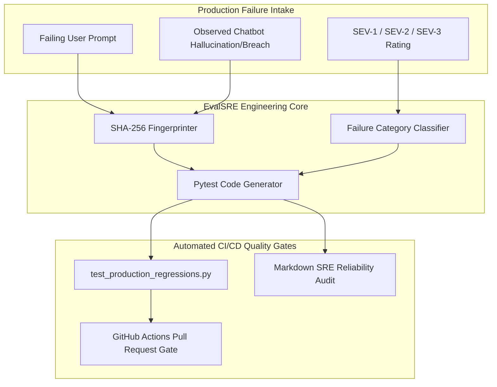

# EvalSRE: AI Incident-to-Regression Engineering Pipeline

[](https://github.com/SriRamKunamsetty/evalsre/actions)
[](https://fastapi.tiangolo.com)
[](https://docs.pydantic.dev)
[](https://www.docker.com/)

> **EvalSRE** is an evaluation engineering pipeline designed to bridge the gap between human evaluation feedback and automated CI/CD regression gates. It ingests production chatbot failures (factual hallucinations, safety breaches, formatting drift) and automatically converts them into deterministic, SHA-256-fingerprinted Pytest test fixtures.

---

## 🎯 Alignerr Competency Mapping

| Alignerr Role Competency | How EvalSRE Proves Mastery |
| :--- | :--- |
| **Submitting Structured, Detailed Feedback** | Formalizes chatbot defects into structured incident schemas with severity ratings (SEV-1/2/3) and failure categorization. |
| **Preventing Chatbot Regressions** | Bridges human qualitative bug discovery into executable CI/CD code, ensuring patched bugs never re-occur in new model checkpoints. |
| **Cryptographic Auditability** | Implements deterministic SHA-256 fingerprinting on prompt-failure pairs for deduplication and immutable audit trails. |
| **Production Engineering** | Standalone FastAPI backend, responsive incident triage board, one-click Pytest suite exporter, Docker container, and GitHub Actions CI workflow. |

---

## ⚙️ SRE Incident Lifecycle



---

## 🚀 Quick Start

### Option 1: Run with Local Python

```bash
# Clone repository
git clone https://github.com/SriRamKunamsetty/evalsre.git
cd evalsre

# Install dependencies
pip install fastapi uvicorn pydantic pytest httpx ruff

# Start the EvalSRE server
uvicorn app.main:app --reload --port 8000
```
Open [http://localhost:8000](http://localhost:8000) in your browser.

### Option 2: Run with Docker

```bash
docker build -t evalsre .
docker run -p 8000:8000 evalsre
```

---

## 🧪 Running Automated Tests & Linting

```bash
# Run complete test suite
pytest -v tests/

# Run static analysis
ruff check .
```

---

## 📡 API Reference

- `GET /health` — Service health check.
- `GET /api/incidents` — Returns all tracked production chatbot incidents.
- `POST /api/incidents/create` — Logs a new production failure with auto-generated SHA-256 fingerprint.
- `POST /api/synthesize` — Synthesizes an executable Pytest regression test fixture from an incident.
- `GET /api/export/pytest` — Generates a downloadable `test_production_regressions.py` suite.
- `GET /api/metrics` — Returns MTTR, resolution rate, and category distribution.
- `POST /api/reports/markdown` — Generates a publication-ready Markdown SRE reliability report.

---

## 👤 Author
**Sri Ram Kunamsetty** — AI Evaluation & Robustness Specialist  
[GitHub Profile](https://github.com/SriRamKunamsetty)
